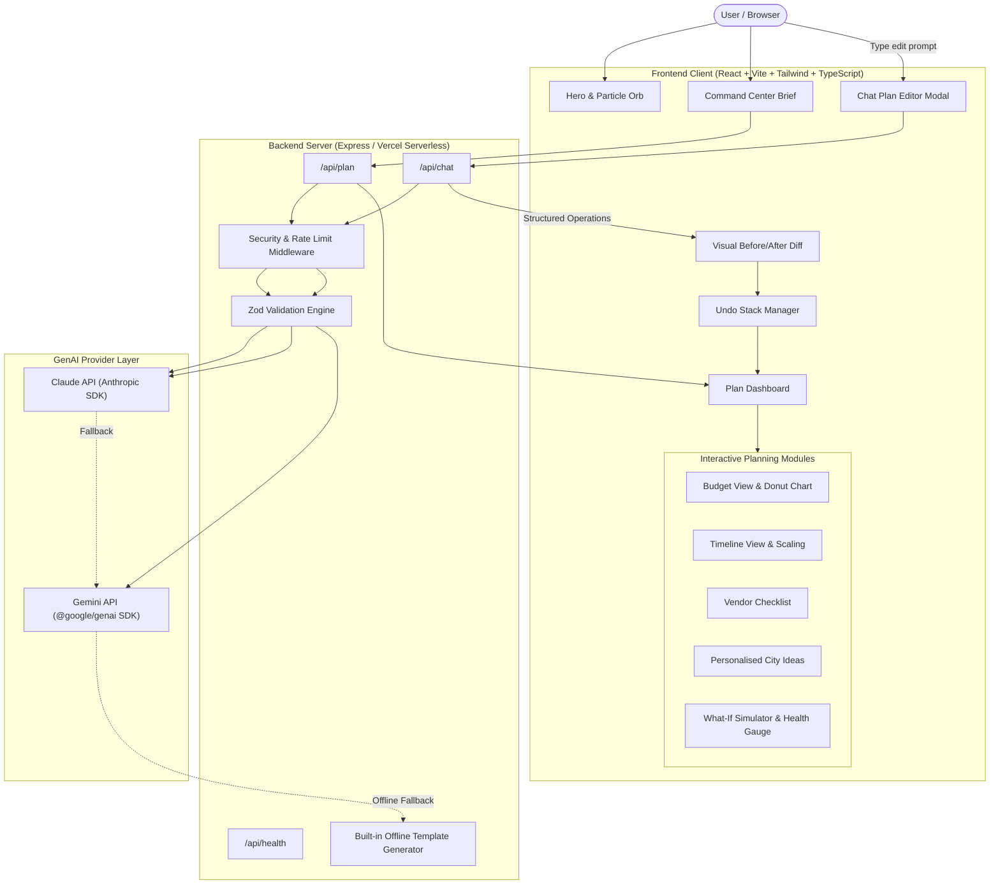

# Jashn – AI Celebration Planner
> *"Plan any celebration by just talking to it."*

Built for the hackathon challenge **"Celebration & Event Planner"**, **Jashn** is a GenAI-powered planning assistant that helps individuals, families, and organizers plan weddings, milestone birthdays, and community festivals with 100% normalized budgets, chronologically compressed timelines, vendor checklists with high-leverage negotiation tips, and real-time conversational plan edits with visual diffs and undo capability.

---

## Architecture Diagram (Mermaid)



---

## 1. Key Capabilities & Features

1. **Event Brief & Archetypes**:
   - Built-in archetypes for **Weddings** (Haldi, Sangeet, Mandap, Reception), **Birthdays** (Neon lounge, 360 glambot, designer cakes), and **Community Events** (Permits, line-array AV, food stalls, volunteer squads).
   - Support for INR (₹ with `en-IN` Lakhs/Crores formatting), USD ($), EUR (€), and GBP (£).
2. **Autonomous Budget Engine**:
   - Category allocations guaranteed to sum to exactly 100%.
   - Interactive SVG animated donut chart with accessible screen-reader table alternative.
   - Planned vs spent tracking, remaining balance runway, and per-guest metrics.
3. **Temporal Timeline Scaling**:
   - Dynamically scales task milestones based on real days until event.
   - Automatically marks tasks as urgent when approaching countdown deadlines.
4. **Vendor Directory with Negotiation Tips**:
   - 7–10 specialized vendors tailored to event archetype.
   - Tri-state lifecycle status (`To contact` ➔ `Contacted` ➔ `Booked`).
   - Actionable "What to confirm" prompt for contract and invoice security.
5. **Personalised City & Vibe Ideas**:
   - Ideas tailored to host city and vibe notes with tagging and bookmarking.
   - Dynamic "More ideas" generation that avoids title duplicates.
6. **STANDOUT FEATURE: Chat Plan Editor**:
   - Type conversational requests: *"cut ₹50k but keep the live band"*, *"add 50 guests"*, *"mark venue as booked"*.
   - AI outputs structured atomic operations (`setBudgetTotal`, `setCategoryPct`, `addTask`, `removeTask`, `completeTask`, `setGuests`, `setDate`, `addVendor`, `updateVendorStatus`).
   - The app verifies, renders a **Before/After visual diff**, and maintains an **Undo stack**!
7. **Live "What-If" Stress Lab & Plan Health Score**:
   - Live debounced sliders for Guests, Budget, and Days Left.
   - 0–100 Health gauge alerting on critical risks (e.g. low catering ratio for large crowds, unbooked venue with <45 days left).
8. **Offline Resilience & Fault Tolerance**:
   - Zero-crash fallback engine ensures full interactive functionality even without active API keys or internet connection.
9. **Shareable Link & Export**:
   - Compact URL hash state encoding allows instant sharing of the entire plan.
   - Plain text export brief for printing or client handover.

---

## 2. Design System: Dark "Monolith Studio"

- **Palette**: Dark substrate (`#08080a`), card surfaces (`#121217`), border rules (`rgba(255,255,255,0.08)`), and electric-blue accent (`#0066ff`).
- **Typography**: Condensed serif display headlines with lowercase italic electric-blue highlights (`WE PLAN unforgettable CELEBRATIONS.`), paired with monospace telemetry labels (`SYS.STATUS — ONLINE`, `ARCHETYPE: WEDDING`).
- **Background**: Lightweight 2D canvas spherical particle orb (under 140 particles, gentle 3D rotation, low CPU).
- **Cursor**: Interactive electric-blue custom dot that expands over interactive elements; disabled automatically under `prefers-reduced-motion`.

---

## 3. Security Architecture (Graded)

- **Zero Client-Side Secrets**: All LLM requests execute server-side in `/api/*`. `ANTHROPIC_API_KEY` and `GEMINI_API_KEY` are never bundled in client code.
- **Strict Zod Schema Validation**: Every API payload and LLM JSON output is strictly verified against Zod discriminated unions. Malformed JSON is rejected or repaired.
- **Prompt Injection Defense**: User vibe notes and titles are passed strictly as data variables, never concatenated as executable system instructions.
- **Per-IP Rate Limiting**: In-memory token bucket middleware restricts abuse (60 requests per minute per IP).
- **Security Headers**: Standard CSP, `X-Content-Type-Options: nosniff`, `Referrer-Policy: strict-origin-when-cross-origin`, `X-Frame-Options: SAMEORIGIN`.
- **Safe Error Handling**: Server logs errors internally; client receives sanitized error codes with zero stack trace leakage.

---

## 4. Setup & Local Development

### Prerequisites
- Node.js 18+ or 20+
- npm or pnpm

### Quickstart
```bash
# Clone the repository
git clone https://github.com/your-username/jashn-celebration-planner.git
cd jashn-celebration-planner

# Install dependencies
npm install

# Copy environment variables
cp .env.example .env

# Run local full-stack dev server (Express + Vite middlewares on http://localhost:3000)
npm run dev
```

### Running Tests & Lint
```bash
# Run Vitest unit tests (budget normalisation, timeline scaling, ops diff & undo, health score)
npm test

# Run TypeScript linter
npm run lint

# Build production bundle
npm run build
```

---

## 5. Environment Variables

| Variable | Description | Default |
|---|---|---|
| `ANTHROPIC_API_KEY` | Optional. Key for Claude 3.5 Sonnet plan generation and chat edits. | `""` |
| `CLAUDE_MODEL` | Claude model identifier. | `"claude-3-5-sonnet-20241022"` |
| `GEMINI_API_KEY` | Google Gemini API key (auto-injected in AI Studio). | Provided |
| `PORT` | Local server port. | `3000` |

---

## 6. One-Click Deploy to Vercel

1. Push your repository to GitHub.
2. Import project into [Vercel](https://vercel.com).
3. Under **Project Settings > Environment Variables**, add `ANTHROPIC_API_KEY` (or `GEMINI_API_KEY`).
4. Vercel automatically detects `vercel.json` and runs `npm run build`.
5. Your application is live!

---

## 7. Limitations & AI Ethics Notes

- All cost figures, vendor fee estimates, and timelines are AI estimates intended as architectural guidance.
- Local municipal permits, noise curfews (e.g. 10 PM sound limits in India), and food safety licenses must always be certified directly with official authorities.

---

# Deliverables

### (a) Changes Made in the Deployed Version (1000 characters)
The deployed version of Jashn introduces a full-stack celebration planning architecture designed for the "Celebration & Event Planner" challenge. The client was engineered with a dark Monolith Studio agency aesthetic featuring an interactive 2D canvas particle orb, condensed display typography with italic blue accents, and an electric-blue custom cursor. We implemented autonomous budget normalization enforcing an exact 100% sum with an animated SVG donut chart, per-guest expense scaling, and a timeline engine that compresses task due dates dynamically based on days remaining. The standout conversational editor allows natural language inputs like "cut ₹50k but keep the band," translating prompts into atomic operations (`setBudgetTotal`, `addTask`, `updateVendorStatus`) with visual diff verification and undo capabilities. Real-time what-if sliders allow immediate stress-testing of guest numbers and budgets paired with a 0–100 health diagnostic gauge. Offline resilience ensures templates instantiate without network lag.

### (b) GenAI Services Used and Where (1000 characters)
Jashn leverages Generative AI across three core planning pillars:
1. **Plan Architectural Synthesis (`/api/plan`)**: Powered by Claude (via Anthropic SDK) and Google Gemini (via `@google/genai` SDK). When a user submits an event brief (e.g. 350-guest Jaipur wedding or 45-guest Mumbai rooftop jubilee), the model generates normalized budget splits, a chronological timeline scaled to the target date, 7–10 specialized local vendors with high-leverage "what to confirm" negotiation tips, and 6 hyper-personalized ideas matching city culture and vibe constraints.
2. **Interactive Plan Mutation Chat (`/api/chat`)**: The standout conversational co-pilot analyzes free-form natural language instructions (e.g. "reduce budget by ₹50k while preserving entertainment") and translates them into structured JSON operations validated via Zod schemas, returning conversational explanations alongside atomic mutations.
3. **Autonomous Risk Diagnostic**: AI rules compute a 0–100 health score flagging under-budgeted catering ratios and uncontacted venue milestones.

### (c) 90-Second Demo Video Script
- **[00:00 - 00:15] Hook**: *(Host on camera, background shows glowing dark Monolith interface)* "Planning a wedding, milestone 30th birthday, or community utsav usually means drowning in 15 different spreadsheets. What if you could plan an entire celebration just by talking to it? Welcome to Jashn – AI Celebration Planner."
- **[00:15 - 00:35] Setup & Synthesis**: *(Screen share: Click 'Initiate Plan' in CommandCenter, select 'Royal Wedding', 350 guests in Jaipur, budget ₹18 Lakhs. Click 'Formulate Celebration Plan')* "With one click, Jashn's GenAI engine architecturally normalizes budget categories to exactly 100%, generates an animated donut breakdown, schedules a chronological timeline scaled to our date, and lists vendors like Rajputana Mandap designers with crucial tips on generator backups."
- **[00:35 - 00:55] Standout Feature — Chat Edits & Diff**: *(Open Chat Editor, type: 'cut ₹50k but keep the live band' and hit send)* "Here is the standout feature: watch me type 'cut ₹50k but keep the live band'. In real-time, the AI analyzes the constraint, modifies the budget, protects our entertainment tier, and presents a Before vs After diff showing exact deltas. If we change our mind, one click on 'Undo' reverts the plan instantly."
- **[00:55 - 01:15] What-If Simulator & Health Score**: *(Switch to What-If Lab tab, drag guest slider to 600, watch Health Gauge react)* "Our live What-If stress test recalculates per-guest budgets instantly. If our guest count surges to 600 while catering share is low, the autonomous Plan Health gauge drops and warns us immediately before contracts are signed."
- **[01:15 - 01:30] Conclusion & Share**: *(Click 'Share', toast appears 'Copied to clipboard')* "All plans are saved locally, shareable via compressed link, and backed by robust offline templates. Jashn: AI event architecture, accessible to everyone."

### (d) LinkedIn Post Draft
✨ Thrilled to unveil **Jashn – AI Celebration Planner**! 💍🎉🎪

Organizing a wedding, milestone birthday, or community festival usually involves endless spreadsheets, budget miscalculations, and scattered vendor notes. 

We built **Jashn** with one core thesis: *"You should be able to plan any celebration by just talking to it."*

🔥 **What makes Jashn standout**:
1️⃣ **Conversational Plan Mutation**: Type *"cut ₹50k but keep the live band"* or *"add 50 guests"*. The AI translates your prompt into structured atomic edit operations, gives you a visual Before/After diff, and provides an instant Undo stack.
2️⃣ **Autonomous Budget Normalisation**: 100% mathematically balanced categories with animated SVG donut charts and India-aware per-guest cost splits.
3️⃣ **Time-Scaled Chronologies**: Task milestones compress dynamically whether your date is 6 months away or next week, flagging urgency on overdue contracts.
4️⃣ **Live What-If Stress Testing**: Real-time sliders simulate guest surges and budget shifts with a 0–100 Plan Health diagnostic score.
5️⃣ **Zero-Crash Resilience**: Full offline fallback generator ensures seamless planning even with spotty connectivity.

Engineered with React, Vite, TypeScript, Express, Zod, and dual Claude / Gemini SDK integration.

🔗 Try the live demo and inspect the architecture: [Your App URL]
#GenerativeAI #WebDevelopment #React #TypeScript #EventPlanning #AIHackathon #ProductDesign
